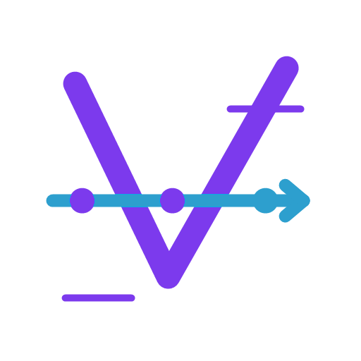
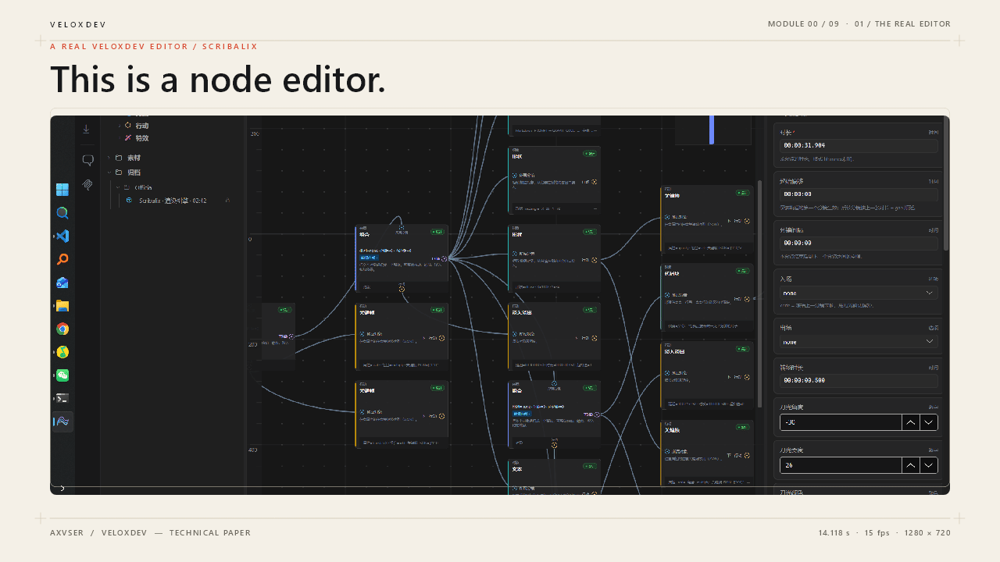
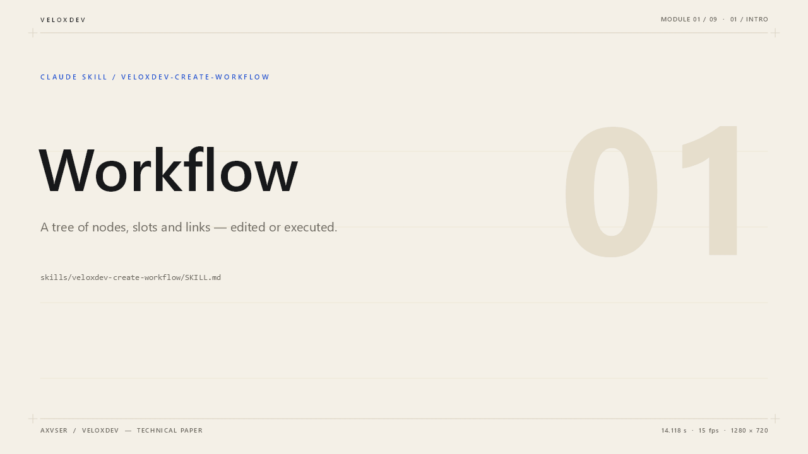
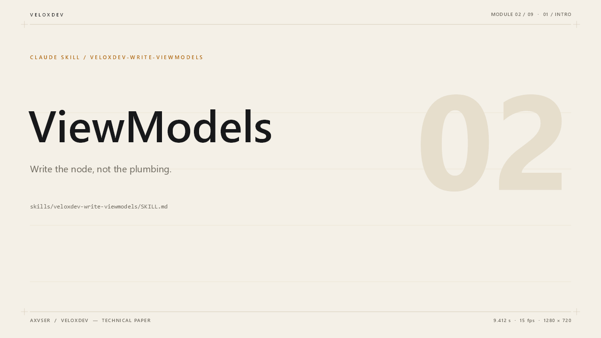
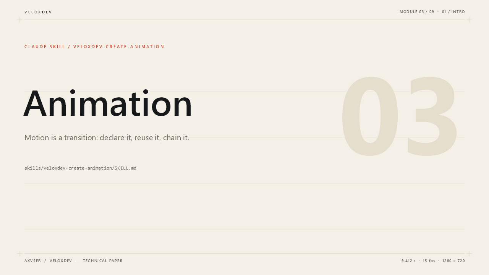
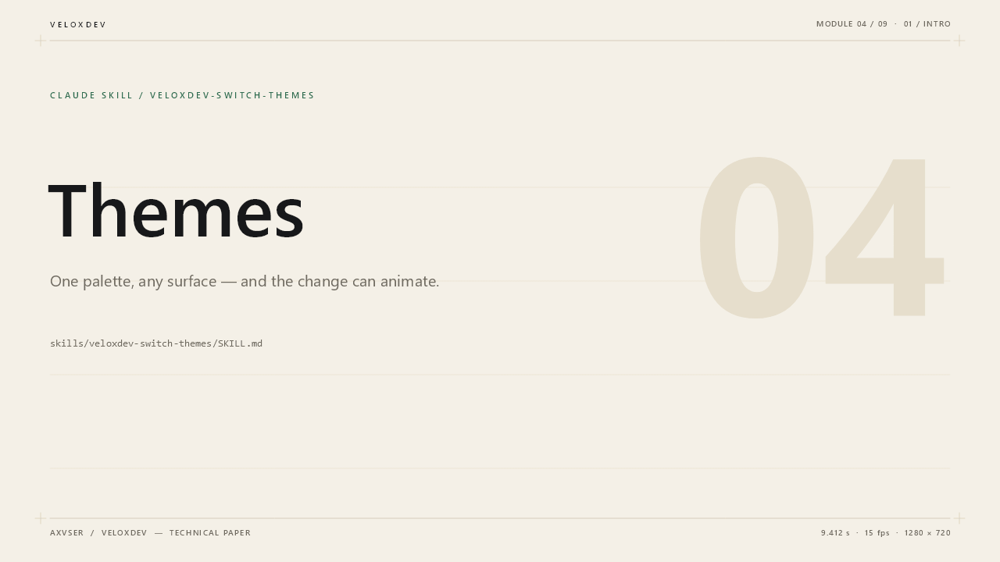
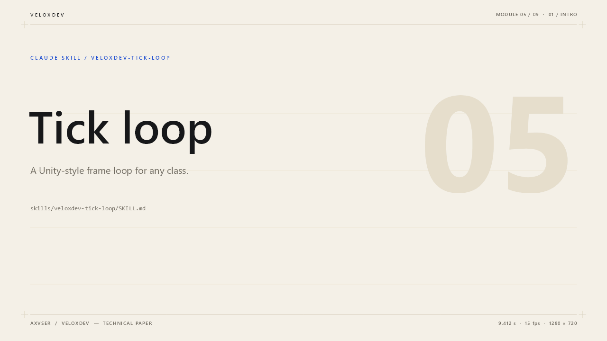
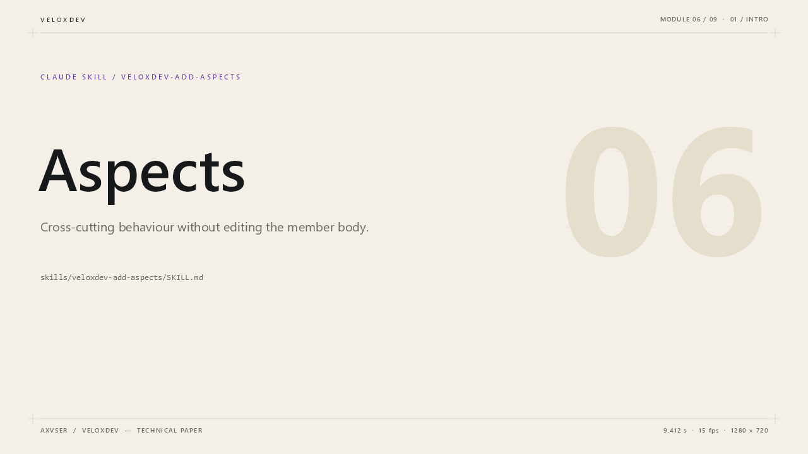
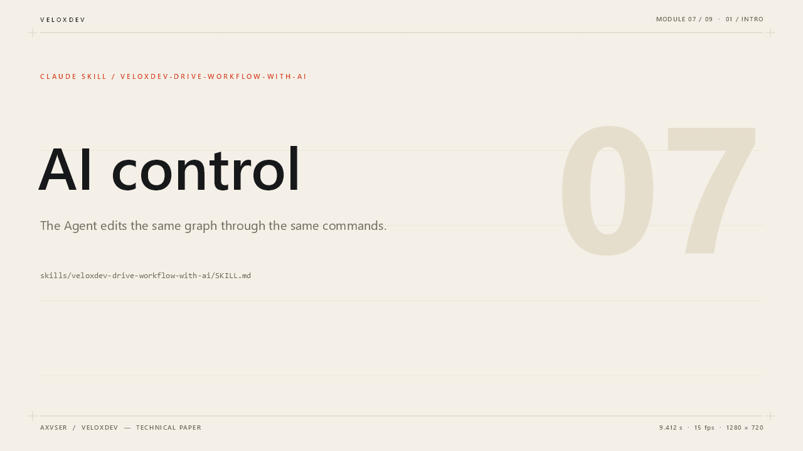
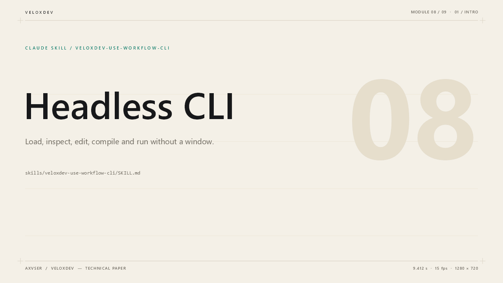

<div align="center">



# VeloxDev

**A node-editor and workflow-engine framework for .NET.**

[](https://axvser.github.io/VeloxDev.Docs/)
[](https://www.nuget.org/packages/VeloxDev.Core)
[](skills/)
[](LICENSE.txt)



<sub>**Overview** · six beats: the real editor, seven GUIs, the pipeline, the four layers, the skills, the close.</sub>

</div>

## Workflow — the core film



<sub><code>skills/veloxdev-create-workflow</code> · a tree of nodes, slots and links — edited or executed.</sub>

## One skill per film

<table>
<tr>
<td align="center" width="50%"><b>ViewModels</b><br><br><sub><code>skills/veloxdev-write-viewmodels</code> · write the node, not the plumbing.</sub></td>
<td align="center" width="50%"><b>Animation</b><br><br><sub><code>skills/veloxdev-create-animation</code> · motion is a transition: declare it, reuse it, chain it.</sub></td>
</tr>
<tr>
<td align="center" width="50%"><b>Themes</b><br><br><sub><code>skills/veloxdev-switch-themes</code> · one palette, any surface — and the change can animate.</sub></td>
<td align="center" width="50%"><b>Tick loop</b><br><br><sub><code>skills/veloxdev-tick-loop</code> · a Unity-style frame loop for any class.</sub></td>
</tr>
<tr>
<td align="center" width="50%"><b>Aspects</b><br><br><sub><code>skills/veloxdev-add-aspects</code> · cross-cutting behaviour without editing the member body.</sub></td>
<td align="center" width="50%"><b>AI control</b><br><br><sub><code>skills/veloxdev-drive-workflow-with-ai</code> · the Agent edits the same graph through the same commands.</sub></td>
</tr>
</table>

## Headless CLI



<sub><code>skills/veloxdev-use-workflow-cli</code> · load, inspect, edit, compile and run without a window.</sub>

All nine are 1280 × 720 at 15 fps. Each skill film is one of the eight
[`skills/`](skills/) `SKILL.md` files, and each film is also a VeloxDev workflow
archive that `veloxdev run` executes end to end. Beats and verification:
[Assets/promo/README.md](Assets/promo/README.md).

## Packages

```powershell
dotnet add package VeloxDev.Core              # the graph model + engine, no UI
dotnet add package VeloxDev.WPF               # one adapter (brings Core)
dotnet add package VeloxDev.Core.Extension    # optional — the AI surface
dotnet tool install --global VeloxDev.Cli     # optional — headless host and MCP server
```

| Platform | Package               | Targets                                                                                |
| -------- | --------------------- | -------------------------------------------------------------------------------------- |
| WPF      | `VeloxDev.WPF`      | `netframework4.6.1` · `net5.0-windows` · `netcoreapp3.0` · `net8.0-windows` |
| Avalonia | `VeloxDev.Avalonia` | `netstandard2.0` · `net6.0` · `net8.0`                                         |
| WinUI    | `VeloxDev.WinUI`    | `net8.0-windows10.0.19041.0` · `net10.0-windows10.0.19041.0`                      |
| MAUI     | `VeloxDev.MAUI`     | `net10.0` · `net10.0-windows10.0.19041.0`                                         |
| WinForms | `VeloxDev.WinForms` | `netframework4.6.1` · `net5.0-windows` · `netcoreapp3.0` · `net8.0-windows` |
| Razor    | `VeloxDev.Razor`    | `net6.0` · `net8.0`                                                               |
| Jalium   | `VeloxDev.Jalium`   | `net10.0`                                                                            |

`VeloxDev.Core` targets `netstandard2.0` through `net8.0` and declares `IsAotCompatible` on `net8.0`; trimming and AOT remain per-platform realities.

### Generate the view suite

```powershell
dotnet new install VeloxDev.WPF.Templates
dotnet new wpf-v-node -n NodeView -ns MyApp.Views
```

<details>
<summary>All seven roles, and the prefix for each adapter</summary>

```powershell
dotnet new wpf-v-tree      -n WorkflowView     -ns MyApp.Views
dotnet new wpf-v-node      -n NodeView         -ns MyApp.Views
dotnet new wpf-v-slot      -n SlotView         -ns MyApp.Views
dotnet new wpf-v-link      -n LinkView         -ns MyApp.Views
dotnet new wpf-v-selector  -n TemplateSelector -ns MyApp.Views
dotnet new wpf-v-decorator -n GridDecorator    -ns MyApp.Views
dotnet new wpf-v-minimap   -n MinimapOverlay   -ns MyApp.Views
```

The other adapters use `ava-v-*`, `winui-v-*`, `maui-v-*`, `winforms-v-*`, `razor-v-*` and `jalium-v-*`.

</details>

## Workflow in code

The whole loop: a node, a wire, a compile and a run.

```csharp
[WorkflowBuilder.Node<BiasNodeHelper>]
public partial class BiasNodeViewModel
{
    public BiasNodeViewModel() => InitializeWorkflow();
    [VeloxProperty] public partial SlotViewModel Input { get; set; }
    [VeloxProperty] public partial SlotViewModel Output { get; set; }
}

tree.CreateNodeCommand.Execute(bias);
tree.SendConnectionCommand.Execute(ticker.Output);
tree.ReceiveConnectionCommand.Execute(bias.Input);

var compiler = new CompilerViewModel();
var graph = (await compiler.CompileAsync(ticker, CompileRole.Root)).Single();
var session = new RuntimeContext { Data = "seed" };
await new RuntimeEngine().RunAsync(graph, session, CancellationToken.None);
```

`BiasNodeHelper.ReceiveAsync` is the node's computation; the generator writes the rest.

- `CompileRole.Terminal` compiles the ancestor cone for one node instead of walking downstream.
- Branches compile to router segments, fan-out to parallel segments with keyed joins, and loops are redirects, not cycles.
- `ValidateConnection` is the host's rule; drag-time previews use it and report a reason.
- `SlotEnumerator<T>` + `[SlotSelectors]` rebuild a node's ports when its configuration changes.

## Also in Core

| Layer                   | What it gives you                                                                                                                                  |
| ----------------------- | -------------------------------------------------------------------------------------------------------------------------------------------------- |
| **MVVM**          | Generated observable properties and async, cancellable commands — no `INotifyPropertyChanged` boilerplate                                       |
| **Transition**    | Timelines, easing, keyframes and scheduling — the animation engine the adapters share                                                              |
| **Theme**         | Runtime theme switching that animates between states instead of snapping                                                                           |
| **AOP**           | Generated aspect interfaces with runtime proxies — intercept a member without touching the class that declares it                                   |
| **Tickable**      | A frame-driven lifecycle loop with a fixed-step pump beside the variable one                                                                       |
| **Serialization** | A closed-world archiver with generated readers and writers — no reflection, and an unseen type fails loudly instead of serializing an empty shell |

<details>
<summary><b>Repository map</b></summary>

| Path                                                                    | What it holds                                                            |
| ----------------------------------------------------------------------- | ------------------------------------------------------------------------ |
| [`Src/Core/VeloxDev.Core`](Src/Core/VeloxDev.Core)                     | The model, canvas mechanics, compiler, runtime and the supporting layers |
| [`Src/Core/VeloxDev.Core.Extension`](Src/Core/VeloxDev.Core.Extension) | The Agent, MCP, skills and sub-agents — additive to Core                |
| [`Src/Adapters/`](Src/Adapters/)                                       | The seven platform adapters                                              |
| [`Src/Templates/`](Src/Templates/)                                     | The seven `dotnet new` item-template packs                             |
| [`Src/Generators/`](Src/Generators/)                                   | The Roslyn generator                                                     |
| [`Examples/`](Examples/)                                               | A demo per feature per GUI, including trimmed-publish demos              |
| [`Docs/`](Docs/)                                                       | The source of the documentation site                                     |

</details>

## License

Released under the [MIT License](LICENSE.txt). © 2025 Axvser
